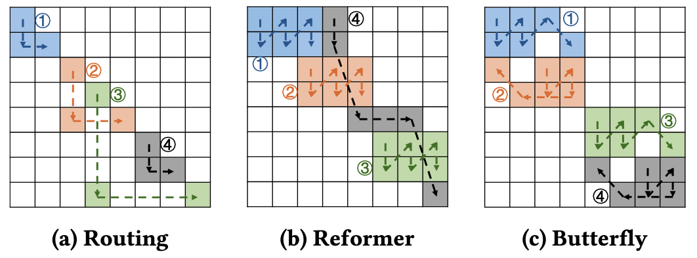

Lihan Hu, <b>Xiaoyang Lu</b>, Xian-He Sun, Peng Jiang

## Background

Block-sparse attention reduces the computational cost of Transformers by computing only selected attention blocks. However, existing GPU implementations often process sparse blocks independently, missing opportunities for data reuse across blocks. Consequently, the same Query (Q), Key (K), and Value (V) blocks are repeatedly loaded from global memory, causing redundant memory traffic and limiting GPU throughput.

Existing implementations such as xFormers and FlashSparse optimize sparse matrix operations but do not explicitly coordinate execution orders to exploit reuse between blocks. Irregular sparsity patterns further complicate reuse optimization because block ordering must balance shared memory capacity, data locality, and GPU parallelism.

## Design

Ziggs is a reuse-aware block scheduling and GPU execution framework that improves block-sparse Transformer performance by exploiting inter-block data reuse. It consists of two coordinated stages:

- **Reuse-Aware Block Scheduling**: Groups sparse attention blocks by row and column similarity and formulates within-group execution ordering as a Markov Decision Process (MDP). Offline Q-learning finds reuse-efficient schedules under shared memory constraints. Ziggs stores schedules for common sparse patterns in a pattern-to-order table and uses a lightweight heuristic for unseen patterns.
- **Scheduling-Guided GPU Execution**: Encodes block execution orders and operand reuse decisions into compact metadata. Optimized SDDMM and SpMM kernels then reuse Q, K, and V operands from GPU shared memory whenever possible, avoiding redundant global memory loads.

  
  
<em>
    Reuse-aware block grouping and execution scheduling
    across different block-sparse attention patterns.
  </em>

## Key Features

- **Q-Learning-Based Block Scheduling**  
  Learns reuse-efficient block execution orders offline while accounting for evolving shared memory contents.
- **Pattern-to-Order Lookup Table**  
  Reuses precomputed schedules for common sparse patterns and applies a lightweight heuristic fallback for unseen patterns.
- **Reuse-Aware SDDMM and SpMM Kernels**  
  Uses compact scheduling metadata to guide operand reuse in shared memory, supporting both CUDA Cores and Tensor Cores.
- **Load-Balanced Fused Attention**  
  Balances work across GPU thread blocks while preserving row-wise softmax normalization and enabling K/V reuse.

## Results

Experiments on NVIDIA A100 and H200 GPUs demonstrate substantial gains over existing sparse attention implementations:

- **Up to 2.05× higher throughput** and **1.44× lower global memory traffic** than xFormers.
- **1.61–3.15× end-to-end speedup** over PyTorch dense attention.
- **Up to 1.78× speedup** over Block-Sparse Attention for long-sequence fused attention.

## Conclusion

Ziggs introduces a **reuse-aware scheduling and execution framework for efficient block-sparse Transformers on GPUs**. By combining offline Q-learning, lightweight scheduling metadata, and optimized GPU kernels, Ziggs systematically exploits inter-block data reuse to reduce redundant memory accesses and improve sparse attention throughput. Its effectiveness across multiple sparsity patterns and GPU architectures demonstrates the value of coordinating block scheduling with shared memory utilization.

[paper](../files/MICRO2025/PACT2026.pdf)
